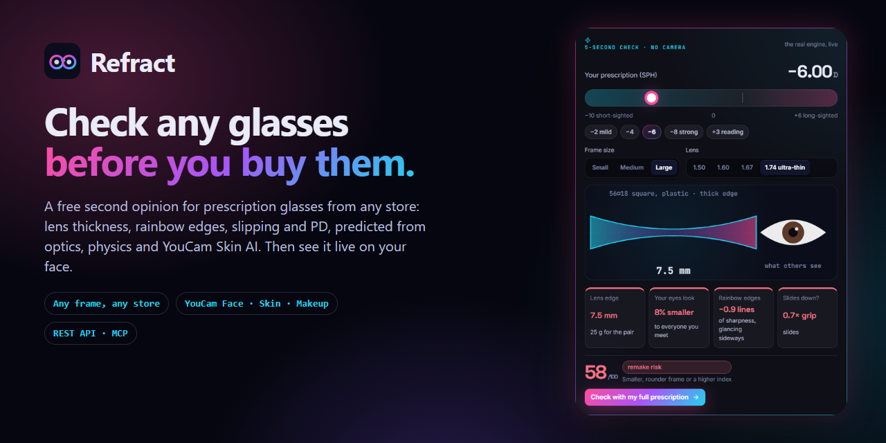

# Refract: know your glasses will work, before you buy them

**7.6% of prescription glasses are redone and 15–22% of eyewear bought online comes back. Refract predicts whether a pair will fail (thick edges, colour fringes, sliding off your nose, wrong PD) before checkout, and shows you live, through _your_ real lenses.**

Refract is a web app (it also installs as a phone app) for people who wear glasses. It renders you **live, through your exact prescription**: a GPU shader re-samples your camera through each lens every frame, so you see how much smaller or bigger your eyes look to others, the edge thickness, and the "cut-in" at the lens rim, with frames tracking your face. It ranks frames and lens index for your Rx, uses **YouCam AI APIs** to retune your eye makeup for your lenses, and drops into **any eyewear store with one script tag**.



Built for the *YouCam API Skin AI & eCommerce VTO Hackathon* (eCommerce VTO track: beauty and eyewear as one look).

---

## Why

- Real lenses change your face. At −8.00 D your eyes look about 9% smaller to everyone else; at +3.00 D they look about 4% bigger. High-minus lenses also get thick at the edge in big frames. A lensless try-on shows none of this, so shoppers find out when the glasses arrive.
- Shortsightedness is projected to affect about half the world's population by 2050 (Holden et al., *Ophthalmology*, 2016). Online eyewear return rates are commonly estimated at 15–20%.
- Makeup artists and lens makers already advise different eye makeup for minus and plus lenses (for example Zeiss and Make Up For Ever guides). No try-on applies that advice to *your* face and *your* lens power.

## What it does

| Screen | What happens |
|---|---|
| **Fit Check (remake risk)** | Four models, each explained with a fix. **Look:** lens thickness + eye-size change. **Sight:** colour fringes by material, from Prentice's rule + Abbe, calibrated to Winter et al. 2015, shown as chart lines of sharpness lost, with a live **Sight simulator**. **Fit:** slip physics from frame + Rx lens weight, head movement, pad friction (silicone 0.61, hard about 0.45; oily skin cuts grip by 15% vs 40%), **oiliness from YouCam Skin Analysis**, nose width from the photo, temple clamp, plus nose-pressure marks above capillary pressure. **Measure:** PD-induced prism vs ANSI Z80.1 0.67 Δ. What-if controls move the score live. |
| **Platform** | `POST /api/v1/risk` (one frame or rank the catalogue), `GET /api/v1/frames`, an **MCP server** (`npm run mcp`) with `rank_frames`, `remake_risk`, `lens_report` and `sight_by_material` for AI shopping agents, and a retailer dashboard (simulated order stream in a Web Worker, ROI calculator, pricing). |
| **Live Rx Mirror** | Real-time try-on: MediaPipe face mesh + a **WebGL2 lens shader** that re-samples every pixel inside each lens from where its light really comes from (sphere, cylinder, axis, depth), at video frame rate. Frames track your face, PD is measured live, and **Showroom ↔ Your Rx** morphs between the lensless view and reality. **Optics X-ray** overlays a 2.5 mm grid bent by the lens and a rim heat-ring coloured by edge thickness. |
| **Store embed** | `public/embed.js`: any store adds one script tag and `data-refract-sku` on a button. Refract opens in a modal with the live mirror; when the shopper picks a frame, the store receives a `refract:add-to-cart` event with frame, lens index and predicted edge thickness. Demo store: `/store/index.html`. |
| **Share card** | A 1080×1350 image of your look through your lenses, with eye-size change, edge, weight and Rx-Fit, made on the device. |
| **Scan** | Live MediaPipe face mesh with checks for distance, centring, head pose and light balance. **Voice guidance and auto-capture**: people who need glasses can't read the screen with them off. Upload is the fallback. |
| **Prescription** | SPH/CYL/AXIS per eye. Shows the eye-size change and a true-scale lens cross-section right away. PD comes from the scan. |
| **Your face** | **YouCam Face Analyzer** reads face shape, eye shape, size, setting, eyelid, brows and colours. **YouCam Skin Analysis** scores dark circles, eye bags, crow's feet, lid droop and tear trough. Refract computes what your lenses will magnify or hide in that area. **YouCam Makeup VTO** renders an Rx-tuned eye look and a generic look side by side. |
| **Frames** | 12 frames with real boxing dimensions, ranked by an explainable **Rx-Fit** score: edge thickness at the recommended index, lens cost, width against your face, decentration, face-shape match. |
| **Studio** | The core. Your photo, or a YouCam makeup render, is re-sampled through each lens per pixel: anisotropic magnification along the cylinder axis, more minification further from the optical centre (the cut-in), power rings and glare, and physically scaled frames. **Showroom ↔ Your Rx** morphs between the lensless view and reality. Lens-index chips show edge, weight, Abbe and price, and say when a thinner lens isn't worth it. |
| **Ask Refract** | An agent (Claude `claude-opus-5-5`, tool use) whose every number comes from tool calls to the same optics engine. Each tool call is visible above the reply, and it only suggests buttons; the shopper confirms. Without an LLM key, a built-in planner answers with the same tools. |
| **Bag** | A lab-ready order sheet (frame, index, coatings, Rx, mono PD with tolerance) plus the eye-look products, with totals in USD and INR. |
| **For retailers** | A catalogue × Rx matrix of edge and centre thickness, how many frames stay under 4.5 mm at each Rx, and a downloadable **Rx-suitability JSON feed** that AI shopping agents can read. |

## YouCam APIs used

All calls go through our server (the key never reaches the browser) on the India-reachable host `https://yce-api-01.makeupar.com`, using the full File API → task → poll flow:

| API | Endpoint | Used for | Units |
|---|---|---|---|
| AI Face Analyzer | `POST /s2s/v2.0/task/face-attr-analysis` (9 features) | Face shape for frame fit; eye shape, size, setting and eyelid for makeup placement; eye, brow and hair colour for shades | 20 |
| AI Skin Analysis | `POST /s2s/v2.1/task/skin-analysis` (HD when the face crop is ≥ 1080 px, else SD; 6 eye-area concerns, JSON + mask overlays) | Dark circles, eye bags, crow's feet/periocular lines, upper and lower lid droop, tear trough: what a plus lens magnifies | 12 / 16 |
| AI Makeup VTO | `POST /s2s/v2.0/task/makeup-vto` (eye_shadow, eye_liner, eyelashes, eyebrows, concealer, skin_smooth) | Rx-tuned look vs. generic look on the user's own photo | 1 each |

About 35–40 units per full profile. The app keeps a units ledger, and the face is auto-cropped so it fills about 70% of the width (the API requires more than 60%), which avoids `error_src_face_too_small`.

## The optics (all in `src/engine/`, unit-tested)

- Meridional power `F(θ) = S + C·sin²(θ − axis)`; spherical equivalent `S + C/2`.
- Apparent eye size seen through the lens: `m = 1 / (1 − d·F)`, with `d` = 12 mm vertex plus extra depth away from the optical centre (this produces the cut-in), applied separately along and across the cylinder axis.
- Edge thickness from lens sag `R − √(R² − r²)`, with `R = 1000(n − 1)/|F|`, around the real frame contour, with decentration from your mono PD. Minimum centre and edge thickness per material.
- Lens weight by integrating thickness over the lens shape × material density; Abbe value per index.
- PD from the iris (horizontal visible iris diameter ≈ 11.7 mm), with camera distance estimated from iris size and a convergence correction from near PD to far PD; ± tolerance shown.

## Run it

```bash
npm install
cp .env.example .env        # add YOUCAM_API_KEY (and optionally ANTHROPIC_API_KEY)
npm run dev                 # http://localhost:5190 (app + API on one port)
npm test                    # 83 tests: optics, sight, slip physics, remake risk, PD, makeup, placement, smoothing, API routes, MCP (real client), agent, limits
npm run mcp                 # MCP server over stdio for Claude / ChatGPT / any MCP client
npm run build               # production build in dist/
```

**No keys?** Open the app and pick a sample profile (Lena −6.50, Helen +2.75). When `public/replay/` holds recordings, the sample profiles replay real YouCam responses, labelled as recorded in the UI. To make them, run `RECORD=1 npm run dev`, then `node scripts/record-personas.mjs` (about 35–40 units per profile). The Studio, frames, retail audit and planner agent need no keys at all.

**Spend protection:** YouCam params are built on the server from fixed presets (the browser only says which analysis or look to run). Each IP gets 24 YouCam runs and 30 agent requests per 10 minutes, and a daily unit budget (`YOUCAM_DAILY_UNITS`, default 400) protects a public demo key.

**Deploy:** `vercel.json` serves the Vite build and routes `/api/*` to one serverless function (`api/index.js`). Set `YOUCAM_API_KEY` (and optionally `ANTHROPIC_API_KEY`) as environment variables.

## Project layout

```
src/engine/     optics.js, sight.js, risk.js, simulate.js, frames.js, fit.js, measure.js, placement.js, makeup.js, youcam.js  (pure, tested)
server/mcp.js   MCP server for AI shopping agents
src/vision/     landmarker.js (MediaPipe), glwarp.js (WebGL2 lens shader), compose.js (lens compositor, X-ray), smooth.js, card.js, image.js
public/         embed.js (store integration), store/ (demo store), replay/ (recorded YouCam responses)
src/pages/      Home, Check, Live, Scan, Rx, Profile, Frames, Studio, Agent, Bag, Retail
server/         youcam.js (File API, task, poll), router.js, agent.js, dev.js
api/index.js    Vercel entry
tests/          node:test suites
```

## Honest limits

- Cosmetic shopping preview, not medical advice. An optician confirms the prescription and PD.
- Frames are drawn by Refract's renderer at real scale. YouCam's eyewear try-on and glasses removal are enterprise products, not part of the self-serve API, so Refract spends the YouCam API where it adds the most: face, skin and makeup.
- Iris-based PD has about ±4% uncertainty (shown in the app); for strong prescriptions the app suggests confirming with an optician.
- The lens model is thin-lens and spherical-surface; real aspheric designs come out somewhat thinner.

## Evidence

Sources, numbers and our own measurement experiment are in [docs/EVIDENCE.md](docs/EVIDENCE.md).

## Credits

- YouCam AI APIs by Perfect Corp. Sample portraits in `public/demo/` are YouCam API documentation sample images.
- MediaPipe Face Landmarker (Apache-2.0). UI motion with anime.js (MIT).

MIT licensed. See `LICENSE`.
